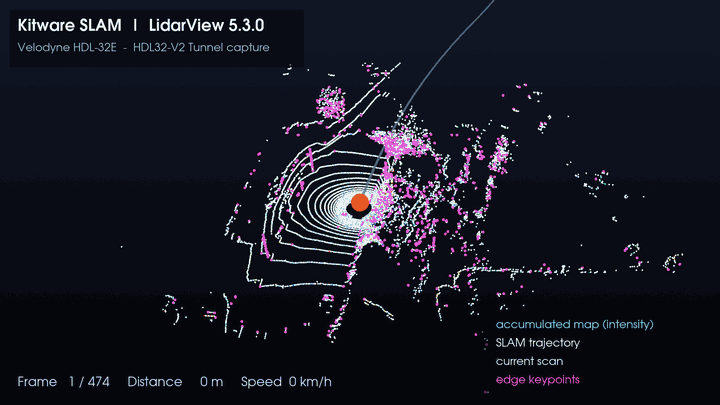
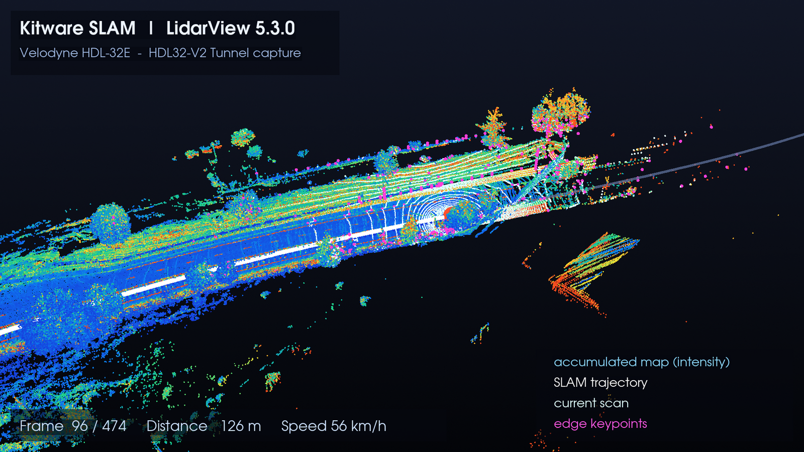
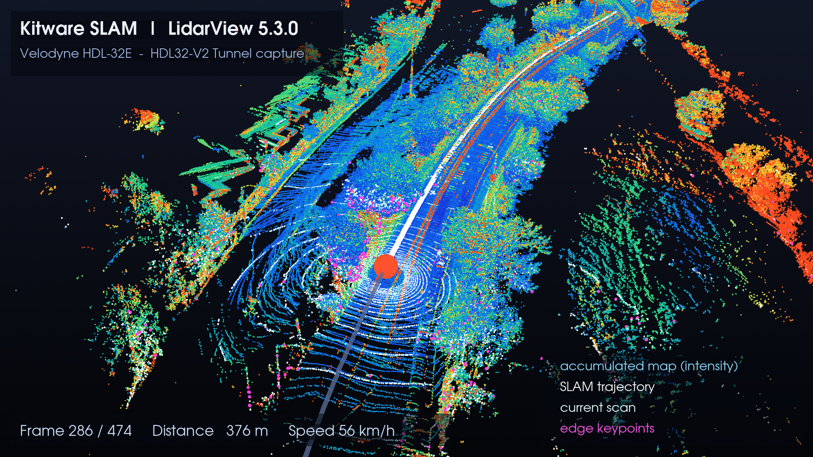
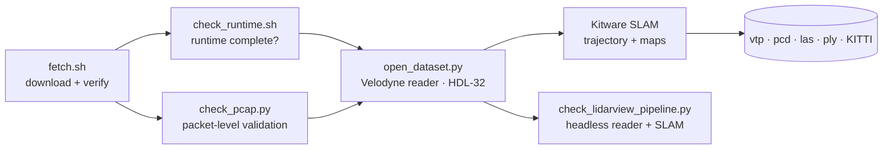

<div align="center">

# LidarView SLAM Workbench

**LiDAR playback, validation and SLAM benchmarking on top of Kitware LidarView 5.3.0.**



<sub>Real data, real SLAM output: accumulated map coloured by intensity, SLAM trajectory, current scan and edge keypoints (HDL32-V2 Tunnel capture, 474 frames, 528 m).</sub>

[](https://github.com/vitaliipavlov1/LidarView/actions/workflows/ci.yml)
[](LICENSE)


</div>

---

## Overview

An end-to-end system for LiDAR data acquisition, validation, SLAM processing and visualisation.
One command provisions a checksum-pinned LidarView runtime and Velodyne HDL-32E captures; independent
validators confirm the runtime, the packet stream and the full reader → SLAM pipeline before anything
is opened in the GUI; the results are reproducible and measured.

| Stage | What it does | Components |
|---|---|---|
| **Acquisition** | Provisions the runtime and datasets with SHA-256 / SHA-512 verification; idempotent, resumable | [`fetch.sh`](scripts/fetch.sh) |
| **Validation** | Packet-level PCAP validation independent of any LiDAR software; runtime completeness and launch checks | [`check_pcap.py`](scripts/check_pcap.py), [`check_runtime.sh`](scripts/check_runtime.sh) |
| **Processing** | Sensor-correct decoding (HDL-32 model pinned) and headless reader → SLAM run with PASS/FAIL verdict | [`open_dataset.py`](scripts/open_dataset.py), [`check_lidarview_pipeline.py`](scripts/check_lidarview_pipeline.py) |
| **Visualisation** | One-command launcher; accumulated map, trajectory and keypoint views | [`run_lidarview.sh`](scripts/run_lidarview.sh) |
| **Documentation** | Architecture notes and a tuned settings reference for HDL-32E data | [`architecture.md`](docs/architecture.md), [`settings.md`](docs/settings.md) |

## Quick start

```bash
git clone https://github.com/vitaliipavlov1/LidarView.git && cd LidarView
./scripts/fetch.sh                                            # runtime + datasets, verified
./scripts/run_lidarview.sh --script scripts/open_dataset.py   # opens the tunnel capture
```

In the GUI press **Play** in the LiDAR Player, then select the reader in the Pipeline Browser and
apply `Filters → Alphabetical → SLAM (online)`.

**Requirements**

| | |
|---|---|
| OS | Ubuntu / Linux x86-64 with a display and OpenGL |
| Disk | ~1.2 GB (≈450 MB download, ≈900 MB extracted runtime) |
| Packages | `curl`, `tar`, `sha256sum`; `libxcb-cursor0` (`sudo apt install libxcb-cursor0`) |

The first start of the GUI can take 1–2 minutes.

## Gallery

<table>
  <tr>
    <td></td>
    <td></td>
  </tr>
  <tr>
    <td align="center">Frame 96 / 474: accumulated map and SLAM trajectory</td>
    <td align="center">Frame 286 / 474: route, trees and current scan</td>
  </tr>
</table>

## Pipeline



## Results

Measured on `HDL32-V2_Tunnel.pcap` (Velodyne HDL-32E, 474 frames at ≈11.7 Hz) with default SLAM settings.

| Check | Result |
|---|---|
| LiDAR packets (UDP 2368, 1206 B payload) | **72,797**, all with valid `0xFFEE` firing-block markers |
| GPS packets (UDP 8308) | 8,066 |
| Capture span | 40.4 s |
| Frames indexed | **474**, ~44,000–50,000 points each |
| Sensor geometry | `laser_id` 0…31, vertical angle −30.67° … +10.67° (matches HDL-32E) |
| SLAM, first 40 frames | **0.10–0.11 s/frame**, 40 poses, 51.9 m of motion, 16,192 edge-map points |
| SLAM, full capture | 474 poses, **527.9 m** path (518.9 m net displacement), 68.7 s total (0.14 s/frame as the map grows), 166,472 edge-map points |
| Real-time budget | 0.085 s/frame at the capture's ≈11.7 Hz; SLAM ran ≈1.2–1.6× slower than real time on the 4-thread reference CPU |

Every number above comes from the scripts in this repository. To reproduce:

```bash
./scripts/check_runtime.sh                               # runtime completeness
python3 scripts/check_pcap.py data/HDL32-V2_Tunnel.pcap  # packet-level validation
runtime/LidarView-5.3.0/bin/lvpython \
    scripts/check_lidarview_pipeline.py data/HDL32-V2_Tunnel.pcap 40    # or 474 for the full capture
```

## Datasets

Velodyne HDL-32E reference captures from the Kitware sample collection on `data.kitware.com`,
SHA-512 verified by `fetch.sh`.

| File | Size | Use |
|---|---|---|
| `HDL32-V2_Tunnel.pcap` | 96.6 MB | Primary smoke test, smallest capture |
| `HDL32-V2_R into Butterfield into Digital Drive.pcap` | 107.2 MB | Urban drive, better for judging SLAM output |

## Opening a capture correctly

LidarView cannot infer the sensor for these captures on its own, so a plain *File → Open* tends to
land in one of two traps:

- the **wrong reader** is chosen → `vtkLidarReader: The parsing of the pcap file failed.`
- the right reader with the **wrong sensor model** → a silently distorted 16-laser VLP-16 cloud.

`scripts/open_dataset.py` pins the Velodyne reader and `Lidar Model = HDL-32`, colours by
`intensity` and resets the camera. The manual route is `File → Open` → **Velodyne LiDAR Reader** →
set **`Lidar Model` → `HDL-32`** → **Apply**.

> The status bar keeps showing `Velodyne-VLP-16` even when the data is correctly interpreted as
> HDL-32. It reads a separate property that is never updated; trust `Lidar Model`.
>
> | `Lidar Model` | `laser_id` | `vertical_angle` | Result |
> |---|---|---|---|
> | `VLP-16` (default) | 0…15 | −15° … +15° | wrong |
> | `HDL-32` | 0…31 | −30.67° … +10.67° | correct |

Avoid `--data <file.pcap>`: it auto-guesses the interpreter (`Hesai-PandarXT-32` for an HDL-32
capture) and the parse fails.

## SLAM outputs

The `SLAM (online)` filter exposes eight named outputs: `Current transformed frame`, `Trajectory`
(one pose per frame with `Time`, `Orientation(Quaternion)`, `Orientation(AxisAngle)`,
`Covariance`), `Edge map`, `Intensity edge map`, `Planar map`, and three `Current … keypoints`
ports (empty unless **Output current keypoints** is ticked).

## Repository layout

```
scripts/
  fetch.sh                      download + checksum-verify runtime and datasets (idempotent)
  run_lidarview.sh              launch the GUI
  open_dataset.py               open a PCAP with the right reader and sensor model
  check_runtime.sh              verify the runtime is complete and launchable
  check_pcap.py                 packet-level PCAP validation (standard library only)
  check_lidarview_pipeline.py   headless reader + SLAM pipeline check
docs/
  architecture.md               plugins, formats, replacing SLAM, real-time budget
  settings.md                   recommended reader / display / SLAM settings, explained
data/                           sample captures (git-ignored)
runtime/                        extracted release and download cache (git-ignored)
```

## Documentation

- [Architecture](docs/architecture.md): how LidarView is assembled from ParaView and plugins, data formats, swapping the SLAM engine, real-time constraints.
- [Settings reference](docs/settings.md): the seven parameters that matter, recommended HDL-32E configuration, symptom-driven debugging.

## Troubleshooting

| Symptom | Fix |
|---|---|
| `Could not load the Qt platform plugin "xcb"` | `sudo apt install libxcb-cursor0` (Qt ≥ 6.5). `fetch.sh` also stages the library locally as a fallback. |
| `The parsing of the pcap file failed` | Wrong reader. Use `Velodyne LiDAR Reader` or `open_dataset.py`. |
| Cloud looks sparse / distorted | `Lidar Model` is still `VLP-16`; set it to `HDL-32` and Apply. |
| Map is a single blob | Frames were not played sequentially from the start. See [settings.md](docs/settings.md). |

## Built on

[Kitware](https://www.kitware.com/) LidarView, ParaView and the Kitware SLAM engine. Components,
sources and licences are listed in [THIRD_PARTY.md](THIRD_PARTY.md).

## Author

**Vitalii Pavlov**: embedded AI, computer vision, C++17, SLAM.
[GitHub](https://github.com/vitaliipavlov1) · [LinkedIn](https://www.linkedin.com/in/vitaliipavlov1)

## License

Scripts and documentation: [MIT](LICENSE).
